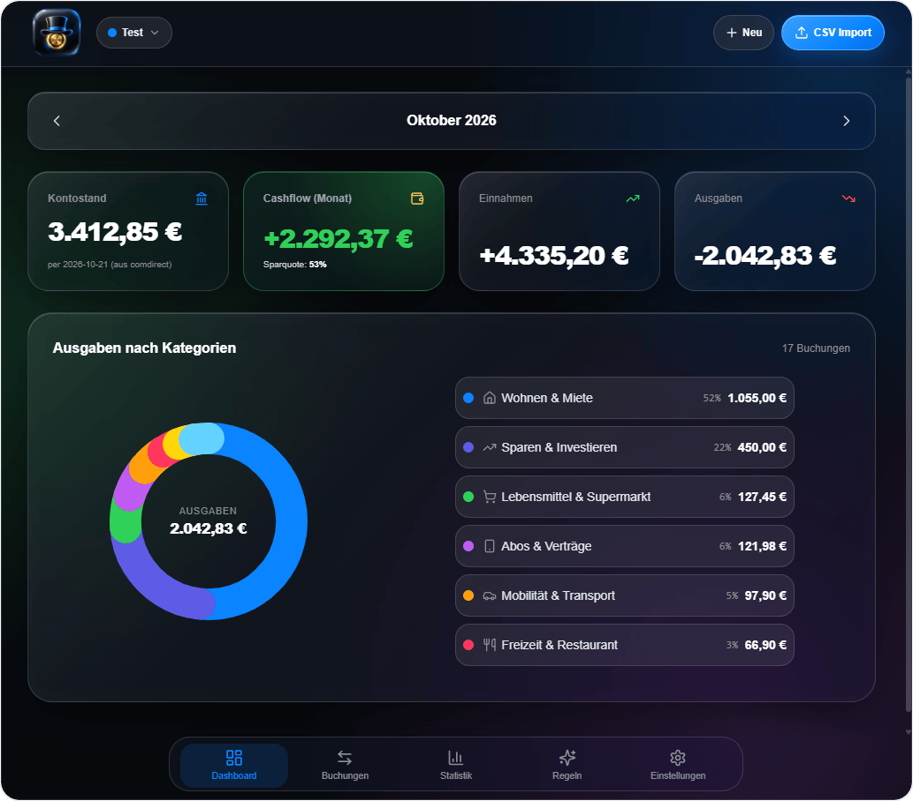

# Dagobert 🪙

<p align="center">
  
</p>

<p align="center">
  
  
  
  
  
  
  <a href="LICENSE"></a>
  <a href="https://buymeacoffee.com/pommesbude" target="_blank"></a>
</p>

<p align="center">
  <b>Schlankes Haushaltsbuch für comdirect-Konten – selbst gehostet im Docker-Container oder bald als iPhone-App.</b><br>
  <i>CSV-Import und Direktabruf per pushTAN, Regeln, Budgetmonat nach Gehalt, Statistik. Kein Abo, kein Tracking, kein fremder Server.</i>
</p>

<p align="center">
  
</p>

---

## ✨ Neu

- **comdirect-Direktabruf per API:** Umsätze und Kontostand ohne CSV-Umweg abrufen, Freigabe per pushTAN. Mit gespeichertem Zugang ein Tipp auf „Sync“.
- **iPhone-App in Entwicklung:** dieselbe Oberfläche nativ auf iOS, mit Face ID und optionalem iCloud-Sync. Erscheint im App Store, sobald sie fertig ist.
- **Budgetmonat „Gehalt bis Gehalt“**, Kontostand am Monatsende und Kontostand-Verlauf in der Statistik.
- **Sparen & Investieren** wahlweise verrechnet, als Überschuss oder als Umbuchung.

---

## 🎯 Warum Dagobert?

Viele Self-Hosted-Finanztools (etwa *Firefly III* oder *Actual Budget*) brauchen mehrere Dienste oder eine externe Datenbank. Mit den Eigenheiten deutscher Bank-Exporte haben sie oft Mühe: kaputte Umlaute, Metadaten-Zeilen im comdirect-Kopf, unstrukturierte Buchungstexte.

**Dagobert geht den schlanken Weg:**
- **Ein Container, eine SQLite-Datei.** Kein Postgres, kein MySQL, kein Redis.
- **Für comdirect gebaut:** CSV-Import mit eigenem Parser und Direktabruf über die offizielle comdirect-API.
- **Eine Oberfläche, zwei Auslieferungen:** im Browser (Docker, PWA-tauglich) und als native iPhone-App.
- **Deine Daten bleiben bei dir:** auf deinem Server oder auf deinem iPhone, auf Wunsch per iCloud zwischen deinen Geräten.

---

## 📱 iPhone-App (in Entwicklung)

Die iOS-App nutzt dieselbe Oberfläche wie die Web-Version, läuft aber **ohne Server**: Alle Daten liegen in einer lokalen SQLite-Datenbank auf dem Gerät.

- **Face ID / Geräte-Sperre** schützt die App beim Öffnen.
- **Bankzugang im iOS-Schlüsselbund (Keychain)** statt in einer Datei.
- **iCloud-Sync (optional):** Abgleich über deine **private** iCloud-Datenbank. Datensätze liegen dort in verschlüsselten Feldern. Dagobert betreibt dafür keinen eigenen Server.
- **CSV-Dateien öffnen:** comdirect-Exporte lassen sich aus „Dateien“ oder anderen Apps an Dagobert übergeben. Importiert wird erst nach deiner Bestätigung.
- **Austausch mit der Docker-Version:** Backups laufen in beide Richtungen. Ein Export aus Docker lässt sich am iPhone einlesen und umgekehrt.

> **Status:** Die App wird gerade auf echten Geräten getestet. Sobald sie fertig ist, erscheint sie im **App Store**. Bis dahin gibt es keine öffentliche Testversion.

---

## 🚀 Funktionen

### 💳 comdirect: CSV-Import und Direktabruf
- **Direktabruf per comdirect-API:** Umsätze und Kontostand direkt abrufen, freigegeben per **pushTAN** in der comdirect-App. Du brauchst dafür deinen eigenen API-Zugang (Client-ID/Secret aus dem comdirect-Entwicklerbereich).
- **Gespeicherter Zugang:** Ist der Zugang hinterlegt, wird aus „Import“ in der Kopfzeile „Sync“, der den Abruf direkt öffnet. Docker speichert den Zugang verschlüsselt (AES-256-GCM), iOS im Schlüsselbund.
- **CSV-Import mit CP1252-Decoder:** Kein Umlaut-Chaos mehr (`Kartenverf¸gung` ➔ `Kartenverfügung`). Metadaten-Zeilen am Dateianfang werden übersprungen.
- **Textzerlegung:** Auftraggeber/Empfänger, Vorgangsart und Verwendungszweck werden aus dem Buchungstext getrennt.
- **Duplikat-Schutz:** Feste Buchungs-IDs verhindern doppelte Einträge bei überlappenden Exporten.

### 📊 Übersicht und Budget
- **Kontostand als Grundlage:** Der Geldbestand rechnet vom letzten comdirect-Saldo oder deinem Startsaldo aus nur mit gebuchten Umsätzen. Einnahmen, Ausgaben und Monatsergebnis sind Auswertung, kein zweiter Bestand.
- **Budgetmonat „Gehalt bis Gehalt“:** Optional zählt ein Gehalt ab einem Stichtag schon zum Folgemonat. Buchungsliste und Statistik bleiben beim echten Buchungsdatum.
- **Monatsergebnis mit Sparquote:** Einnahmen und Ausgaben in einer Kachel, abschaltbar.
- **Vergangene Monate:** Kontostand am Monatsende neben dem aktuellen Stand.
- **Sparen & Investieren:** Wahlweise verrechnet, als Überschuss-Zeile oder als Umbuchung außerhalb von Einnahmen/Ausgaben.
- **Alle Kategorien im Blick:** Ein Tipp auf eine Kategorie öffnet die passenden Buchungen des Zeitraums.

### 📈 Statistik
- **Kontostand-Verlauf:** Monatsend-Stände pro Jahr oder die letzten 12 Monate, zum Antippen, mit Tabellenansicht.
- **Ausgaben nach Kategorie** als interaktives Donut-Diagramm.

### 🧠 Regeln
- **Kriterien:** Empfänger, Verwendungszweck, Buchungstext, Betrag oder Buchungsart (enthält, exakt, Regex).
- **Regel beim Kategorisieren anlegen:** Dagobert schlägt nach dem Kategorisieren direkt eine Regel vor.
- **Rückwirkend anwenden** auf passende ältere Buchungen.
- **Standard-Regelwerk** für gängige Händler, Supermärkte, Tankstellen und Abos.

### 👥 Profile und Sicherheit
- **Getrennte Profile** für Privat, Geschäft oder Familie, mit eigenen Farben, Symbolen und PIN.
- **Server-PIN (Docker):** Ohne bestätigte PIN liefert die API keine Daten. Dazu kommen eine Sperre gegen Durchprobieren und eine Sitzung von 12 Stunden.
- **Backups:** Export pro Profil oder für alle Profile. Vor einem ersetzenden Import wird der alte Stand gesichert.
- **Kein Tracking, keine Telemetrie.**

---

## 🐳 Installation (Docker)

Dagobert läuft als All-in-One-Container. Du brauchst **weder Git noch Node.js**.

### Methode 1: Portainer (empfohlen für Homelab/Server)

1. **Portainer** ➔ Environment wählen ➔ **Stacks** ➔ **Add Stack**.
2. Name eingeben (z. B. `dagobert`) und Folgendes einfügen:

```yaml
services:
  dagobert:
    image: ghcr.io/hehljo/dagobert:latest
    container_name: dagobert
    restart: unless-stopped
    ports:
      - "5052:5052"
    volumes:
      - dagobert_data:/app/data

volumes:
  dagobert_data:
```

3. **Deploy the stack** ➔ im Browser `http://SERVER-IP:5052` öffnen.

### Methode 2: Synology DiskStation (Container Manager, DSM 7.2)

1. **Container Manager** ➔ **Projekt** ➔ **Erstellen**.
2. Projektname `dagobert`, Pfad z. B. `/docker/dagobert`.
3. *docker-compose.yaml erstellen* und einfügen:

```yaml
services:
  dagobert:
    image: ghcr.io/hehljo/dagobert:latest
    container_name: dagobert
    restart: unless-stopped
    ports:
      - "5052:5052"
    volumes:
      - /volume1/docker/dagobert/data:/app/data
```

4. **Weiter** ➔ **Fertigstellen** ➔ im Browser `http://DISKSTATION-IP:5052` öffnen.

### Methode 3: Docker-Befehl

```bash
docker run -d \
  --name dagobert \
  --restart unless-stopped \
  -p 5052:5052 \
  -v dagobert_data:/app/data \
  ghcr.io/hehljo/dagobert:latest
```

### Methode 4: Aus dem Quellcode bauen

```bash
git clone https://github.com/hehljo/Dagobert.git
cd Dagobert
docker compose up -d --build
```

---

## 🛠️ Entwicklung

| Zweck | Befehl |
|---|---|
| Abhängigkeiten | `npm install` |
| Entwicklungsserver | `npm run dev` |
| Unit- und Node-Tests | `npm test` |
| Browser-Workflows (Playwright) | `npm run test:ui` |
| Produktions-Build inkl. Typcheck | `npm run build` |
| iOS-Projekt synchronisieren | `npm run cap:sync` |

**Aufbau in Kürze:** React 19 + Vite + Tailwind. Die Oberfläche spricht nur eine Repository-Schnittstelle. Im Browser geht die per HTTP an den Express-Server mit SQLite, in der iOS-App über Capacitor an ein Swift-Plugin mit eigener SQLite und CloudKit. Details: [`MOBILE_ARCHITECTURE.md`](MOBILE_ARCHITECTURE.md).

Testdaten sind ausschließlich synthetisch, z. B. [`docs/comdirect_demo_umsaetze.csv`](docs/comdirect_demo_umsaetze.csv).

---

## ☕ Support

Dagobert entsteht unabhängig als Open-Source-Projekt. Wenn es dir Klicks und Nerven spart, freue ich mich über einen Kaffee:

<p align="center">
  <a href="https://buymeacoffee.com/pommesbude" target="_blank">
    
  </a>
</p>

---

## 📄 Lizenz

**[MIT-Lizenz](LICENSE)**: frei nutzbar, veränderbar und selbst hostbar.
Copyright (c) 2026 Johannes Hehl.

Dagobert ist kein Angebot der comdirect bank AG und steht in keiner Verbindung zu ihr. „comdirect“ ist eine Marke ihres Inhabers.

---

## 🏷️ Topics
`personal-finance` · `self-hosted` · `budgeting` · `comdirect` · `local-first` · `docker` · `sqlite` · `react` · `typescript` · `capacitor` · `ios` · `cloudkit` · `synology` · `homelab` · `csv-parser`
