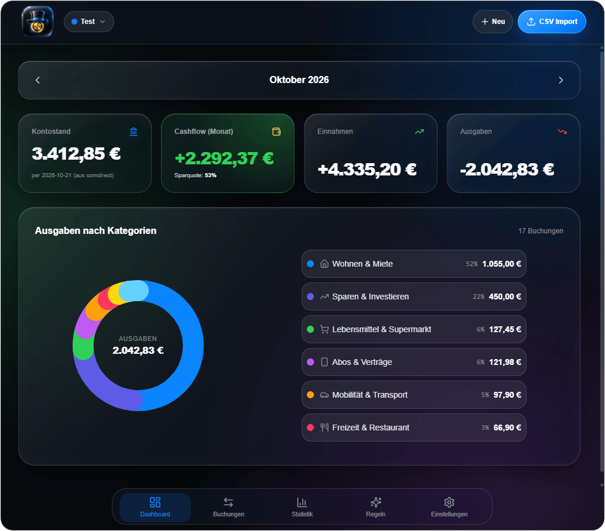

# Dagobert 🪙

<p align="center">
  
</p>

<p align="center">
  
  
  
  
  
  
  
  <a href="LICENSE"></a>
  <a href="https://buymeacoffee.com/pommesbude" target="_blank"></a>
</p>

<p align="center">
  <b>Schlankes, selbstgehostetes Finanz- & Haushaltsbuch mit intelligentem CSV-Import, Multi-Profil-Verwaltung und kompromissloser Datensicherheit.</b><br>
  <i>Keine Cloud. Kein Abo. Kein Ressourcen-Fresser. Entwickelt für Synology DiskStation, Raspberry Pi oder jeden Docker-Host.</i>
</p>

<p align="center">
  <a href="https://buymeacoffee.com/pommesbude" target="_blank">
    
  </a>
</p>

<p align="center">
  
</p>

---

## 🎯 Warum Dagobert?

Bestehende Self-Hosted-Finanztools (wie *Firefly III* oder *Actual Budget*) sind entweder ressourcenhungrige Container-Monster mit mehreren Hilfsdiensten, erfordern externe Datenbank-Cluster oder scheitern an den typischen Eigenheiten deutscher Bank-Exporte (Umlaut-Salat, comdirect Header-Metadaten, unstrukturierte Buchungstexte).

**Dagobert geht den minimalistischen Weg:**
- **Ein einziger schlanker Docker-Container** (unter 25 MB RAM im Leerlauf).
- **Zentrale SQLite-Datenbank** im Container gemountet – keine Postgres-, MySQL- oder Redis-Container nötig.
- **Spezialisiert auf deutsche Bankauszüge** (aktuell mit nativem Spezial-Parser für **comdirect**, weitere Banken wie ING, DKB oder Sparkasse auf Anfrage problemlos erweiterbar).
- **Mobile-First & PWA-tauglich:** Am iPhone/Android im Browser mit nativen Gesten, Bottom-Navigation und OLED Dark Mode bedienbar.

---

## 🚀 Kern-Features

### 🔒 Kompromisslose Privatsphäre & Sicherheit
- **100 % Local-First & DSGVO-konform:** Deine Bankumsätze und Salden verlassen niemals dein eigenes Heimnetzwerk. Keine Drittanbieter, kein Tracking.
- **Globale Server-PIN:** Schützt Profile serverseitig in SQLite mit Brute-Force-Sperre (Rate-Limiting) und 12h-Sitzung. Bevor eine PIN nicht verifiziert ist, liefert die API keinen einzigen Datensatz aus.
- **Biometrische App-Sperre:** Unterstützt zusätzlich Passkeys (Face ID / Touch ID) sowie lokale Geräte-PINs.

### 💳 Smarter comdirect CSV-Import
- **Automatischer CP1252-Decoder:** Kein Umlaut-Chaos mehr (`Kartenverf¸gung` ➔ `Kartenverfügung`).
- **Dynamisches Header-Skipping:** Erkennt die comdirect-Metadatenzeilen am Dateianfang automatisch und startet direkt bei den Buchungen.
- **Intelligente Textzerlegung:** Trennt automatisiert Auftraggeber/Empfänger, Vorgangsart und Verwendungszweck aus dem unstrukturierten Buchungstext.
- **Stichtags- & Saldoprüfung:** Erkennt den echten Konto-Saldo laut Auszug und gleicht historische Buchungen lückenlos ab.
- **Duplikat-Schutz:** Deterministische Prüfsummen verhindern doppelte Buchungen bei sich überschneidenden Monats-Exporten.
- *Weitere Banken:* Die Parser-Architektur ist modular ausgelegt – weitere deutsche und europäische Institute können auf Wunsch ergänzt werden.

### 🧠 Intelligente Erkennungsregeln (Rules Engine)
- **Granulare Kriterien:** Filtere gezielt nach *nur Empfänger*, *Verwendungszweck*, *Buchungstext*, *Betrag* oder *Buchungsart* (enthält, ist exakt, Regex).
- **One-Click Rule Learning:** Beim Kategorisieren einer Buchung schlägt Dagobert direkt vor, eine Regel für die Zukunft anzulegen.
- **Rückwirkendes Anwenden:** Neue oder bearbeitete Regeln können mit einem Klick rückwirkend auf alle passenden historischen Buchungen angewendet werden.
- **Standard-Regelwerk:** Enthält vordefinierte Regeln für gängige Händler, Supermärkte, Tankstellen und Abos.

### 👥 Multi-Profil & UX
- **Echte Profiltrennung:** Verwalte private Finanzen, Geschäftskonto oder Familienbudget sauber getrennt mit individuellen Farben, Icons und PIN-Schutz.
- **Inline-Kategorien:** Lege neue Kategorien direkt beim Kategorisieren einer Buchung an, ohne das Modal zu verlassen.
- **Visuelles Dashboard:** Cashflow-Cockpit mit Einnahmen, Ausgaben, Sparquote und interaktivem SVG-Donut-Diagramm.

---

## 🚀 Schnelle Installation (In 2 Minuten startklar)

Dagobert läuft als schlanker All-in-One-Container. Du musst **weder Git noch Node.js** installiert haben!

---

### Methode 1: Portainer (Empfohlen für Homelab / Server)
Ideal für jedes System mit Portainer (Synology, Unraid, Raspberry Pi, VPS):

1. Öffne **Portainer** ➔ Wähle dein Environment ➔ Klicke auf **Stacks** ➔ **Add Stack**.
2. Name eingeben (z. B. `dagobert`).
3. Folgende Konfiguration im Web-Editor einfügen:

```yaml
version: 3.8

services:
  dagobert:
    image: ghcr.io/hehljo/dagobert:latest
    container_name: dagobert
    restart: unless-stopped
    ports:
      - "5052:5052"
    volumes:
      - dagobert_data:/app/data

volumes:
  dagobert_data:
```

4. Klicke unten auf **Deploy the stack**.
5. Fertig! Öffne im Browser: `http://<deine-server-ip>:5052`

---

### Methode 2: Synology DiskStation (Container Manager / DSM 7.2)
Ganz ohne Terminal direkt über die Synology-Weboberfläche:

1. Öffne im Synology DSM den **Container Manager**.
2. Klicke links auf **Projekt** ➔ **Erstellen**.
3. Projektname: `dagobert`, Pfad: Wähle deinen Docker-Ordner (z. B. `/docker/dagobert`).
4. Wähle *docker-compose.yaml erstellen* und füge folgenden Code ein:

```yaml
version: 3.8

services:
  dagobert:
    image: ghcr.io/hehljo/dagobert:latest
    container_name: dagobert
    restart: unless-stopped
    ports:
      - "5052:5052"
    volumes:
      - /volume1/docker/dagobert/data:/app/data
```

5. Klicke auf **Weiter** ➔ **Fertigstellen**. Der Container wird automatisch heruntergeladen und gestartet.
6. Im Browser aufrufen: `http://<diskstation-ip>:5052`

---

### Methode 3: Schneller Docker-Befehl (Terminal Einzeiler)
Wenn du Docker auf Linux, macOS oder Windows installiert hast:

```bash
docker run -d \
  --name dagobert \
  --restart unless-stopped \
  -p 5052:5052 \
  -v dagobert_data:/app/data \
  ghcr.io/hehljo/dagobert:latest
```

---

### Methode 4: Für Entwickler (Lokal aus Quellcode bauen)
Falls du selbst am Code mitentwickeln möchtest:

```bash
# 1. Repository klonen
git clone https://github.com/hehljo/Dagobert.git
cd Dagobert

# 2. Container mit lokalem Multi-Stage Build starten
docker compose up -d --build
```

---

## 🛠️ Lokale Entwicklung & Tests

```bash
# Abhängigkeiten installieren
npm install

# Entwicklungsserver starten
npm run dev

# Tests ausführen (Vitest & Node Test-Runner)
npm test

# Vollständige UI- & Browser-Workflows via Playwright prüfen
npm run test:ui

# Produktions-Build erstellen
npm run build
```

---

## ☕ Support & Kaffee

Dagobert wird unabhängig als Open-Source-Projekt für das eigene Homelab entwickelt. Wenn dir das Tool gefällt oder dir bei deinen Finanzen Klicks und Nerven spart, freue ich mich über einen Kaffee:

<p align="center">
  <a href="https://buymeacoffee.com/pommesbude" target="_blank">
    
  </a>
</p>

---

## 📄 Lizenz & Urheberschaft

Dieses Projekt ist unter der **[MIT-Lizenz](LICENSE)** lizenziert – frei nutzbar, modifizierbar und selbst hostbar.
Copyright (c) 2026 Johannes Hehl.

---

## 🏷️ GitHub Topics & Tags
`personal-finance` · `self-hosted` · `fintech` · `budgeting` · `comdirect` · `local-first` · `docker` · `sqlite` · `react` · `typescript` · `synology` · `homelab` · `csv-parser`
